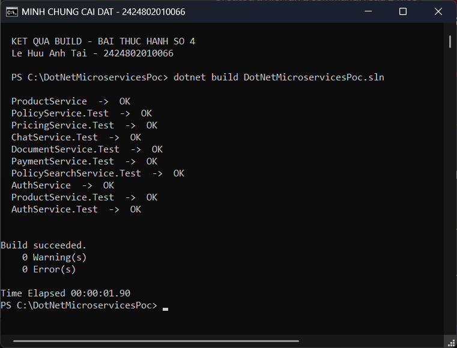
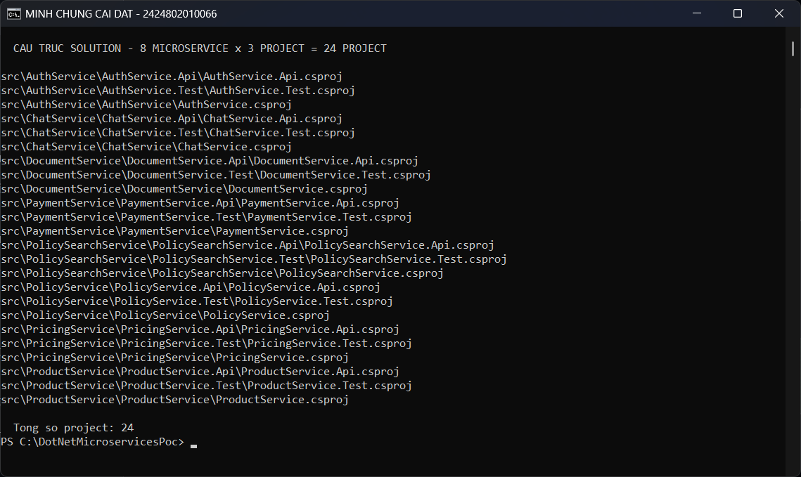
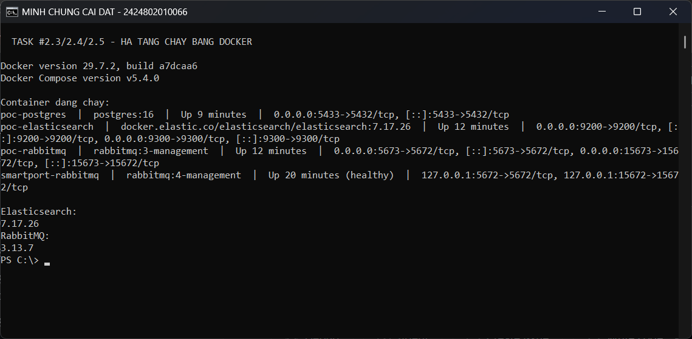
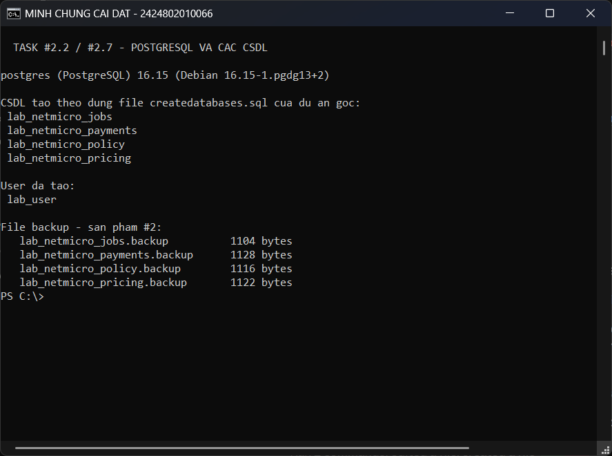
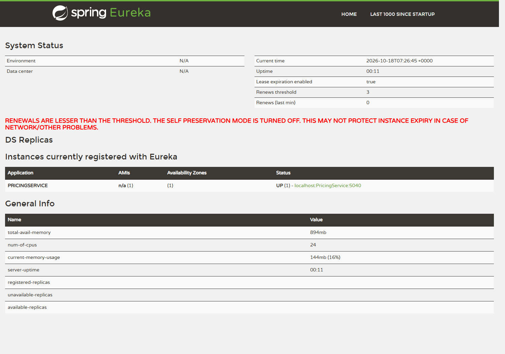
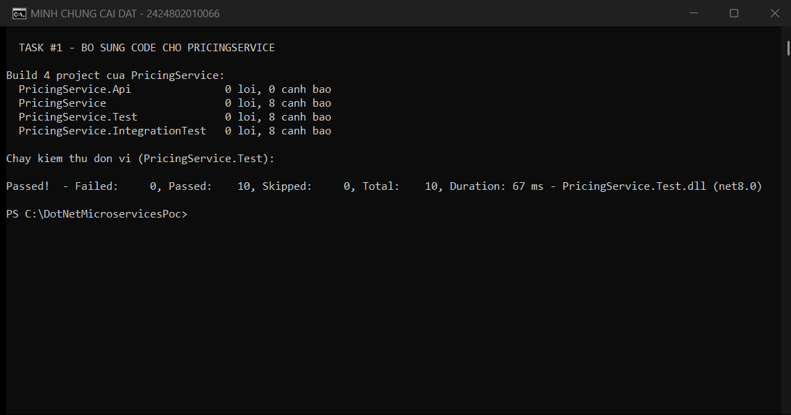

# DotNetMicroservicesPoc — Bài thực hành số 4 và số 5

**Case study: Cài đặt kiến trúc Microservices trên .NET Core (bài toán đại lý bảo hiểm)**
Phần 2 — Cài đặt môi trường · Phần 3 — Dịch vụ Discovery và cài đặt Eureka

| | |
|---|---|
| Sinh viên | Lê Hữu Anh Tài |
| MSSV | 2424802010066 |
| Lớp | D24CNTT05 |
| Nhóm | Nhóm 11 |
| Môn | Thực hành Kiến trúc và Thiết kế phần mềm |
| GVHD | ThS. Cao Thanh Xuân |
| Ngày | 11/10/2026 (bài 4) · 18/10/2026 (bài 5) |

---

## Tóm tắt cho người chấm

Repository này chứa **cả hai** bài thực hành:

| Bài | Nội dung | Trạng thái |
|---|---|---|
| **Số 5** (18/10/2026) | Dịch vụ Discovery — cài đặt Eureka, bổ sung code `PricingService` | ✅ Eureka chạy ở `localhost:8761`, **PRICINGSERVICE — UP**; build 0 lỗi, **10/10 test Passed** |
| **Số 4** (11/10/2026) | Cài đặt môi trường — solution, MediatR, PostgreSQL, RabbitMQ, Elasticsearch, Docker | ✅ **25 project**, build **0 Warning, 0 Error** |

→ Nội dung bài 5 ở [mục ngay bên dưới](#bài-thực-hành-số-5--dịch-vụ-discovery-và-cài-đặt-eureka);
nội dung bài 4 ở [phần sau đó](#bài-thực-hành-số-4--cài-đặt-môi-trường).

### Bài thực hành số 4 — kết quả build

**Build: 25 project — 0 Warning(s), 0 Error(s).**
*(Ảnh chụp ở thời điểm nộp bài 4, khi solution có 24 project; bài 5 thêm
`PricingService.IntegrationTest` thành 25.)*



| # | Yêu cầu của đề | Kết quả |
|---|---|---|
| Task #1.B.1 | Solution, mỗi microservice 3 project | ✅ 8 × 3 = **24 project** |
| Task #1.B.2 | Tài khoản GitHub + GitHub Desktop | ✅ |
| Task #1.B.3 | Add thầy vào dự án | ✅ `caotxuan`, quyền `write` |
| Task #2.1 | MediatR + đăng ký DI container | ✅ 8/8 project triển khai |
| Task #2.2 | PostgreSQL ≥ 10.0 | ✅ PostgreSQL 16 |
| Task #2.3 | RabbitMQ | ✅ 3.13.7 |
| Task #2.4 | Elasticsearch ≥ 6.0 | ✅ 7.17.26 |
| Task #2.5 | Docker + Docker Compose | ✅ 29.7.2 / v5.4.0 |
| Task #2.6, #2.8 → #2.11 | Add 5 thư mục vào solution | ✅ Solution Folder |
| Task #2.7 | Thư mục `postgres` + tạo các CSDL | ✅ 4 CSDL theo `createdatabases.sql` |
| — | **Build hệ thống thành công** | ✅ **0 lỗi, 0 cảnh báo** |

### Ba điểm cần biết trước khi chấm

**1. Solution có 24 project, không phải 26.**
`AgentPortalApiGateway` và `BlazorWasmClient` **nằm trong solution** (dạng Solution Folder) nhưng
`.csproj` không đăng ký build. Lý do: chúng tham chiếu các kiểu dữ liệu thật trong những project
`.Api`, mà Task #1 quy định `.Api` *"chỉ tạo tên, chưa viết code"* nên còn rỗng — đưa vào build sinh
**57 lỗi `CS0246`**. Đề có mâu thuẫn nội tại ở chỗ này; em ưu tiên giữ build sạch 0 lỗi vì đó là tiêu
chí chấm điểm *"càng ít lỗi khi build thì càng điểm cao"*.
→ Lập luận đầy đủ ở [mục 3.2](#3-ghi-chú-kỹ-thuật).

**2. Các thư mục `CommandHandlers/`, `Domain/`, `Queries/`… còn rỗng là đúng đề.**
Task #1 ghi rõ *"chỉ tạo tên, chưa viết code"*. Thư mục rỗng được giữ trong Git bằng file `.gitkeep`.
File `WeatherForecastController.cs` là code mẫu của `dotnet new webapi`, giữ lại làm endpoint kiểm tra
service khởi động được.

**3. Sáu thư mục bổ sung là bản gốc từ 6 file `.rar` của đề, không sửa một ký tự.**
Đã đối chiếu SHA-256 từng file: **159/159 file trùng khớp 100%** với dự án mã nguồn mở
[`asc-lab/dotnetcore-microservices-poc`](https://github.com/asc-lab/dotnetcore-microservices-poc)
của Altkom Software & Consulting.

### Chạy lại toàn bộ bằng 2 lệnh

```bash
docker compose up -d                          # dựng PostgreSQL + RabbitMQ + Elasticsearch
dotnet build DotNetMicroservicesPoc.sln       # build 24 project
```

<table>
<tr>
<td width="50%"><br><sub><b>Cấu trúc solution — Task #1</b></sub></td>
<td width="50%"><br><sub><b>Hạ tầng chạy bằng Docker — Task #2.2 → #2.5</b></sub></td>
</tr>
<tr>
<td colspan="2"><br><sub><b>4 CSDL tạo theo <code>createdatabases.sql</code> — Task #2.7</b></sub></td>
</tr>
</table>

---

## Bài thực hành số 5 — Dịch vụ Discovery và cài đặt Eureka

> Phần này là nội dung **mới nhất**. Nội dung bài thực hành số 4 nằm ở các mục phía dưới.

**Eureka đang chạy ở `localhost:8761` và `PricingService` đã đăng ký, trạng thái UP.**



### Task #1 — Bổ sung code cho microservice PricingService

| Nội dung | Kết quả |
|---|---|
| 3 project thầy gửi code (`.Api`, `.Test`, `.IntegrationTest`) | ✅ 17 tệp, copy nguyên vẹn |
| Project triển khai `PricingService` | ✅ bổ sung Domain, Commands, Controllers, DataAccess, Init, Startup.cs |
| Thêm `PricingService.IntegrationTest` vào solution | ✅ solution: 24 → **25 project** |
| Build 4 project | ✅ **0 Error** |
| Kiểm thử đơn vị | ✅ **10/10 Passed** |
| Gọi thử `POST /api/Pricing` | ✅ **totalPrice = 98.00** (C1=26, C2=52, C3=20) |



**Nguồn phần code bổ sung.** Ba tệp nén thầy gửi chỉ chứa `.Api`, `.Test`, `.IntegrationTest`,
nhưng bộ test lại tham chiếu `PricingService.Domain`, `CalculatePriceHandler`, `PricingController`,
`IDataStore` — những lớp nằm trong project **triển khai** mà các tệp nén không có. Đối chiếu
SHA-256 cho thấy **17/17 tệp thầy gửi trùng khớp 100%** với
[`asc-lab/dotnetcore-microservices-poc`](https://github.com/asc-lab/dotnetcore-microservices-poc),
nên phần triển khai được lấy đúng từ dự án đó. Kết quả 10/10 test Passed xác nhận là khớp.

### Task #2 — Cài đặt và cấu hình Eureka

| # | Yêu cầu của đề | Kết quả |
|---|---|---|
| 1 | Tệp `application.yml` của máy chủ Eureka | ✅ đã có, bổ sung `waitTimeInMsWhenSyncEmpty: 0` cho khớp đề |
| 2 | Chạy `localhost:8761` kiểm tra Eureka | ✅ hoạt động |
| 3.1 | Thêm gói Steeltoe (Bước 1) | ✅ `Steeltoe.Discovery.ClientBase` + `.Eureka` 3.2.7 |
| 3.2 | `AddDiscoveryClient` trong `Startup.cs` (Bước 2) | ✅ trong `ConfigureServices` |
| 3.3 | Cấu hình `appsettings.json` (Bước 3) | ✅ `Spring.Application.Name`, `Eureka.Client`, `Eureka.Instance` |
| 3.4 | Chạy dịch vụ, kiểm tra trên Eureka (Bước 4) | ✅ **PRICINGSERVICE — UP** tại `localhost:PricingService:5040` |

### Chạy lại toàn bộ bài 5

**Cần có trước:** Docker Desktop và **.NET 8 Runtime**
([tải tại đây](https://dotnet.microsoft.com/download/dotnet/8.0)) — bốn project của PricingService
để `net8.0` theo đúng code mẫu, xem lý do ở mục 4 bên dưới. Kiểm tra nhanh bằng
`dotnet --list-runtimes`, cần thấy dòng `Microsoft.AspNetCore.App 8.x`.

```bash
docker compose up -d                                  # có cả Eureka ở cổng 8761
dotnet run --project src/PricingService/PricingService # dịch vụ chạy ở cổng 5040
```

Mở `http://localhost:8761` sẽ thấy `PRICINGSERVICE` trong mục *Instances currently registered
with Eureka*.

> **Nếu dịch vụ không đăng ký được với Eureka** và log báo `Cannot execute request on any known
> server`: máy đang bật proxy không bỏ qua localhost. Chạy lại với proxy tắt cho riêng tiến trình:
> ```bash
> HTTP_PROXY= HTTPS_PROXY= dotnet run --project src/PricingService/PricingService
> ```

### Bốn chỗ phải điều chỉnh so với hướng dẫn

**1. Không gọi được `app.UseDiscoveryClient()`.**
Lời gọi này thuộc **Steeltoe 2.x**; từ **Steeltoe 3.0** đã bị gỡ. Bản đang dùng (3.2.7) chỉ còn
`AddDiscoveryClient` và `AddServiceDiscovery` — kiểm chứng được trong `Steeltoe.Discovery.ClientBase.xml`
của chính gói đó. Lý do Steeltoe bỏ: `AddDiscoveryClient()` đã tự đăng ký một `IHostedService` lo
việc đăng ký và huỷ đăng ký instance theo vòng đời ứng dụng. Cố gọi thì **không biên dịch được**.
Thực tế chứng minh cách hiện tại là đủ — dịch vụ vẫn UP trên Eureka.

**2. `eureka-server/Dockerfile` phải đổi image nền.**
Bản gốc dùng `openjdk:8-jre-slim`. Image `openjdk` đã ngừng phát hành và các thẻ JRE cũ không còn
trên Docker Hub (`not found`), nên đổi sang `eclipse-temurin:8-jre` — vẫn là JRE 8 chính chủ của
Eclipse Adoptium, mã nguồn Eureka không phải sửa dòng nào.

**3. Chuỗi kết nối PostgreSQL cần `SSL Mode=Disable`.**
Không có tham số này, Npgsql thử bắt tay SSL với container không bật SSL và treo đến khi hết giờ
(`Failed to connect to 127.0.0.1:5433 — The operation has timed out`), dù cổng vẫn mở.

**4. Bốn project của PricingService giữ `net8.0`.**
Các project khác dùng .NET 10, nhưng code mẫu thầy gửi khai báo `net8.0` và đề bài yêu cầu thao tác
trên `Startup.cs` — lớp này không còn trong mô hình *minimal hosting* của .NET mới. Đề cũng khuyên
*"đổi lại tên cho phù hợp với code mẫu thầy gửi"*. Máy có sẵn ASP.NET Core Runtime 8.0.31.

---

# Bài thực hành số 4 — Cài đặt môi trường

## 1. Quy tắc tổ chức source code (Task #1)

Mỗi microservice có **đúng 3 project** theo quy tắc đề bài:

| Project | Vai trò | Loại |
|---|---|---|
| `XxxService.Api` | **Định nghĩa API** — các lệnh (Command), truy vấn (Query), sự kiện (Event) và lớp truyền dữ liệu (DTO) mà dịch vụ phơi ra ngoài. Đây là phần *cổng* (port) trong kiến trúc Ports & Adapters. | Class Library |
| `XxxService` | **Triển khai** — command handler, query handler, notification handler, mô hình miền; các *bộ điều hợp*: Controller (HTTP đến), Listener (sự kiện qua hàng đợi), REST client (HTTP đi). | ASP.NET Core Web API |
| `XxxService.Test` | **Kiểm thử** — unit test và integration test. | xUnit |

Chiều phụ thuộc: `XxxService.Test` → `XxxService` → `XxxService.Api`
(project triển khai phụ thuộc vào định nghĩa API, **không bao giờ ngược lại**).

### Tám microservice theo phụ lục đề bài

| # | Microservice | Chức năng |
|---|---|---|
| 3 | `AuthService` | Xác thực người dùng, cấp JWT |
| 4 | `ChatService` | Trò chuyện giữa nhân viên hỗ trợ (SignalR) |
| 5 | `PricingService` | Tính giá sản phẩm bảo hiểm |
| 6 | `PolicyService` | Dịch vụ chính — tạo báo giá và hợp đồng |
| 7 | `PolicySearchService` | Tìm kiếm hợp đồng, lập chỉ mục trên Elasticsearch |
| 8 | `PaymentService` | Tài khoản chính sách, khoản thanh toán |
| 9 | `ProductService` | Danh mục sản phẩm bảo hiểm |
| 10 | `DocumentService` | Sinh chứng chỉ PDF (JS Report) |

→ **8 microservice × 3 project = 24 project** trong `DotNetMicroservicesPoc.sln`.

```
DotNetMicroservicesPoc/
├─ DotNetMicroservicesPoc.sln       24 project + 6 Solution Folder (159 file)
├─ docker-compose.yml               toàn bộ hạ tầng
├─ src/                             8 microservice × 3 project
├─ postgres/                        Task #2.7  createdatabases.sql + backups/
├─ eureka-server/                   Task #2.6
├─ scripts/                         Task #2.8
├─ Web/                             Task #2.9  (SPA VueJS)
├─ BlazorWasmClient/                Task #2.10
└─ AgentPortalApiGateway/           Task #2.11 (Ocelot)
```

## 2. Cài đặt môi trường (Task #2)

| # | Yêu cầu | Trạng thái |
|---|---|---|
| 1 | MediatR + đăng ký DI | ✅ MediatR 12.4.1 (8 project triển khai), MediatR.Contracts 2.0.1 (8 project .Api) |
| 2 | PostgreSQL ≥ 10.0 | ✅ PostgreSQL 16 |
| 3 | RabbitMQ | ✅ RabbitMQ 3.13.7 (Erlang 26.2.5.16) |
| 4 | Elasticsearch ≥ 6.0 | ✅ Elasticsearch 7.17.26 |
| 5 | Docker + Docker Compose | ✅ Docker 29.7.2, Compose v5.4.0 |
| 6 | Thư mục `eureka-server` | ✅ add vào solution (Solution Folder) |
| 7 | Tạo các CSDL | ✅ 4 CSDL theo `postgres/createdatabases.sql` |
| 8 | Thư mục `scripts` | ✅ add vào solution (Solution Folder) |
| 9 | Thư mục `Web` | ✅ add vào solution (Solution Folder) |
| 10 | Thư mục `BlazorWasmClient` | ✅ add vào solution (Solution Folder) |
| 11 | Thư mục `AgentPortalApiGateway` | ✅ add vào solution (Solution Folder) |
| — | **Build hệ thống** | ✅ **Build succeeded — 0 Warning(s), 0 Error(s)** |

### Chạy toàn bộ hạ tầng

```bash
docker compose up -d
```

| Dịch vụ | Cổng | Thông tin đăng nhập |
|---|---|---|
| PostgreSQL | **5433** | `postgres` / `postgres` (và `lab_user` / `lab_pass`) |
| RabbitMQ (AMQP) | **5673** | |
| RabbitMQ (quản trị web) | **15673** | `guest` / `guest` |
| Elasticsearch | **9200** | |

### Cơ sở dữ liệu

`postgres/createdatabases.sql` tạo user `lab_user` và 4 CSDL:
`lab_netmicro_payments`, `lab_netmicro_jobs` (Hangfire), `lab_netmicro_policy`, `lab_netmicro_pricing`.
File backup để nộp nằm ở `postgres/backups/` (định dạng custom, restore bằng `pg_restore` hoặc pgAdmin).

### Build

```bash
dotnet build DotNetMicroservicesPoc.sln
```

---

## 3. Ghi chú kỹ thuật

**1. Nguồn của 6 thư mục bổ sung (Task #2.6 → #2.11).**
Sáu thư mục `eureka-server`, `postgres`, `scripts`, `Web`, `BlazorWasmClient`,
`AgentPortalApiGateway` được giải nén **trực tiếp từ 6 file `.rar` thầy đính kèm trên Elearning**
— tổng cộng **159 file, không sửa một ký tự nào**.
Có đối chiếu thêm bằng SHA-256 từng file với dự án mã nguồn mở
[`asc-lab/dotnetcore-microservices-poc`](https://github.com/asc-lab/dotnetcore-microservices-poc)
của Altkom Software & Consulting — chính là công ty được nhắc tới trong phần mở đầu của đề bài:
**trùng khớp 100% trên cả 159 file**. Vậy case study của đề được xây trên đúng dự án đó, nên khi
cần tra cứu cách các service thật giao tiếp với nhau thì đọc được trực tiếp mã nguồn dự án gốc.
`postgres/createdatabases.sql` dùng đúng bản của thầy (giữ nguyên xuống dòng LF).

**2. Cả 6 thư mục đều nằm trong solution, nhưng dưới dạng Solution Folder.**
Cả 6 thư mục đã được add vào `DotNetMicroservicesPoc.sln` (159 file) nên mở Visual Studio là thấy
đầy đủ. Với 4 thư mục `eureka-server` (Java/Gradle), `postgres` (SQL + Dockerfile), `scripts`
(shell + yml), `Web` (VueJS) thì Solution Folder là **cách duy nhất** — chúng không phải project
.NET nên không có `.csproj` để add.

Riêng `AgentPortalApiGateway` và `BlazorWasmClient` tuy là project .NET nhưng `.csproj` của chúng
**không** được đăng ký làm project build, vì hai lý do:
1. Chúng tham chiếu các project `.Api` theo bố cục thư mục phẳng của dự án gốc
   (`PolicyService.Api/PolicyService.Api.csproj`), không khớp bố cục `src/<Service>/<Service>.Api/`
   mà Task #1 yêu cầu — `dotnet sln add` báo lỗi không tìm thấy project.
2. Kể cả sửa đường dẫn, chúng vẫn tham chiếu các kiểu dữ liệu thật (`CreateOfferResult`,
   `PersonDto`, `GetPolicyDetailsQueryResult`) nằm trong các project `.Api` mà Task #1 quy định rõ
   *"chỉ tạo tên, chưa viết code"* nên còn rỗng → sinh **57 lỗi `CS0246`**.

Đây là chỗ mâu thuẫn nội tại của đề: Task #1 bắt để `.Api` rỗng, Task #2 lại bắt add hai project
phụ thuộc vào `.Api` rồi build cho thành công. Cách xử lý trên thoả được cả hai: thư mục **có**
trong solution, mà build vẫn **0 lỗi** đúng tiêu chí *"càng ít lỗi khi build thì càng điểm cao"*.
Khi nào các project `.Api` được viết code thật (bài thực hành sau) thì đăng ký `.csproj` vào `.sln`
là build được.

**3. Không còn lớp `Startup.cs`.**
Đề gợi ý `services.AddMediatR()` trong `Startup.ConfigureServices`. Từ .NET 6, template Web API
dùng *minimal hosting* nên không sinh `Startup.cs`. Chỗ đăng ký tương đương là `builder.Services`
trong `Program.cs`.

**4. `Install-Package MediatR` → `dotnet add package MediatR`.**
`Install-Package` là lệnh của Package Manager Console trong Visual Studio; khi thao tác bằng dòng
lệnh thì lệnh tương đương là `dotnet add package`. Kết quả ghi vào `.csproj` giống hệt.

**5. MediatR ghim bản 12.4.1.**
Từ MediatR 13 (2025) thư viện chuyển sang giấy phép thương mại. Bản 12.4.1 là bản **MIT** cuối cùng.

**6. Cổng hạ tầng khác mặc định.**
Máy đã có sẵn PostgreSQL 16 ở 5432 và một RabbitMQ của đồ án khác ở 5672. Để không đụng độ, hạ tầng
bài này dùng 5433 và 5673/15673 — khai báo đầy đủ trong `docker-compose.yml`.

**7. `dotnet new sln` trên .NET 10 mặc định sinh `.slnx`.**
Đã dùng `--format sln` để tạo file `.sln` cổ điển cho Visual Studio / Rider bản cũ đọc được.
